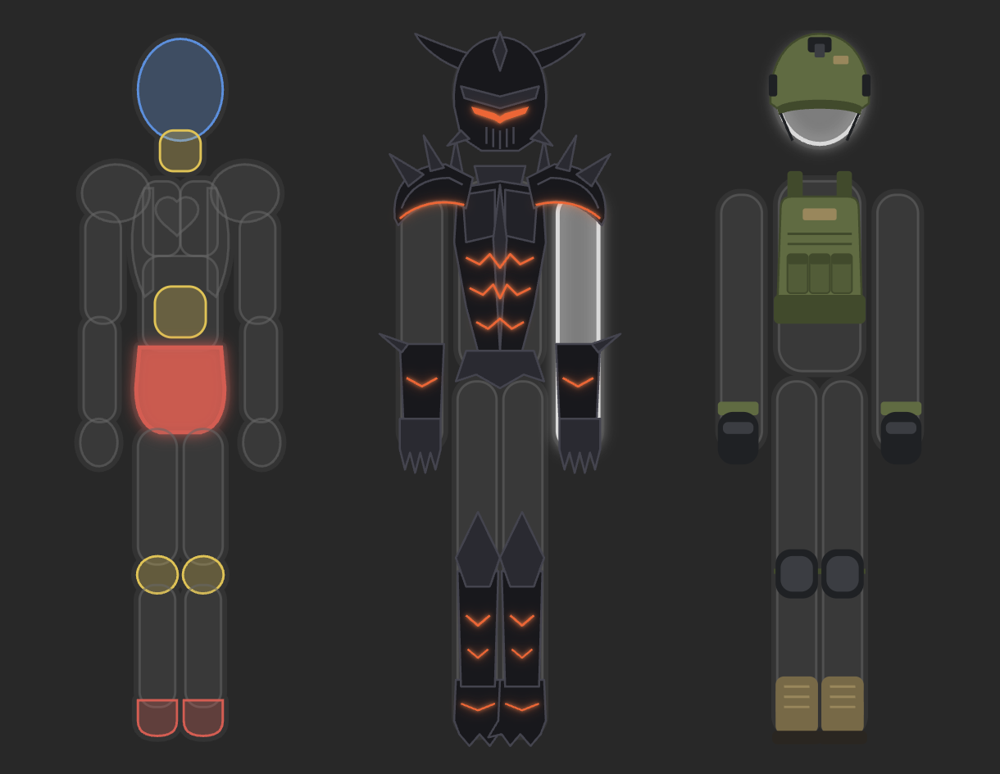
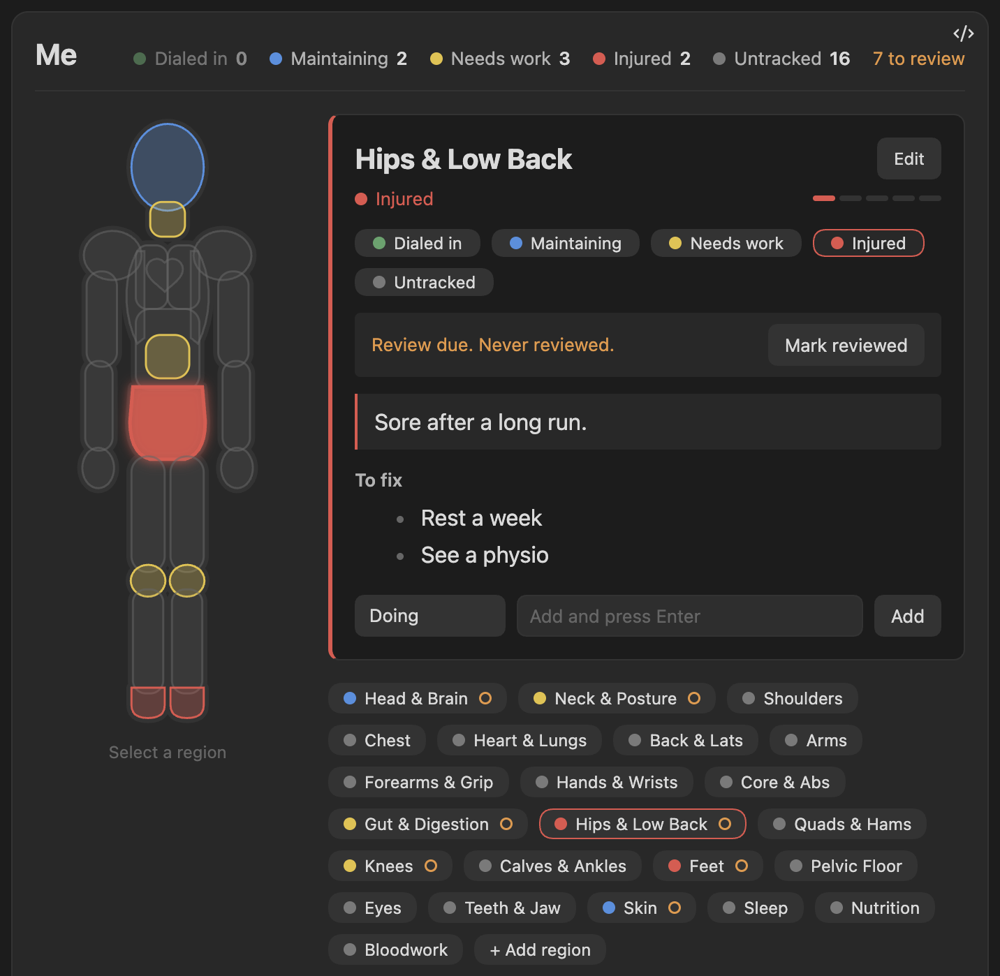
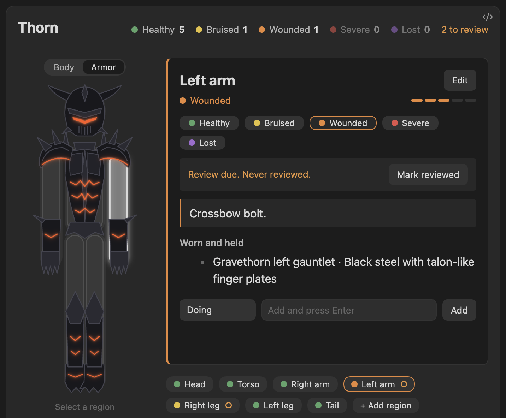
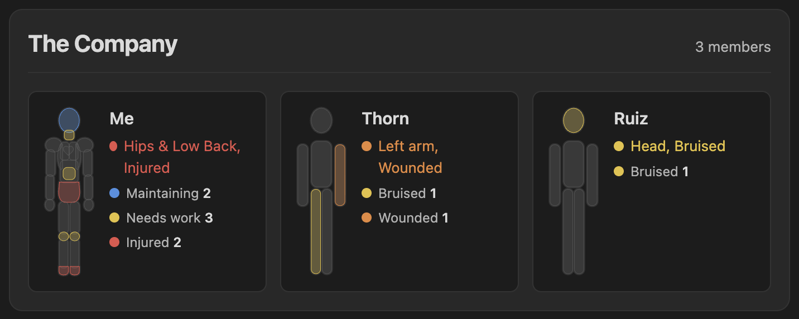
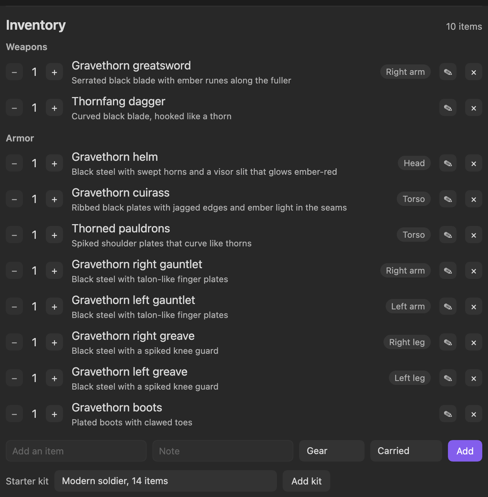
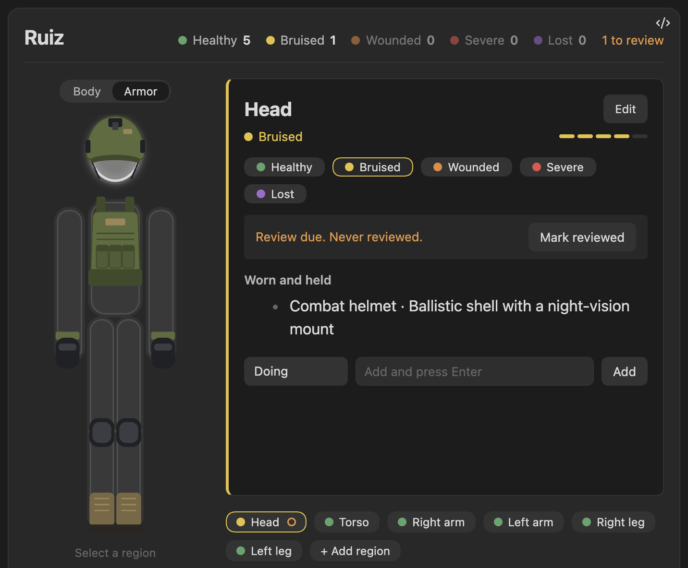

# Character Info

**A character screen for your notes.** Track your own body like a game's health screen, or keep a whole tabletop party at a glance, with armor drawn right on the figure.



Click a part of the figure to see how it is doing, what you are doing about it, what to do next, and its history. Everything lives in plain Markdown notes, so search, links, Bases, Dataview and sync all keep working. Nothing leaves your vault.

- **For your body.** Twenty-three areas from head to bloodwork, each with a state, notes, a to-do list, links to your notes and a dated history. Gentle reminders flag what you have not looked at in a while.
- **For your tabletop party.** Characters with wounds limb by limb, a party view of everyone at once, an inventory with starter kits, and armor you can see.
- **Plain text all the way down.** A profile is a few lines in a code block. Edit the text and the figure follows.

## Quick start

1. Install **Character Info** from Community plugins and enable it.
2. In any note, open the command palette and run **Character Info: New profile**. Pick a name and a template.
3. Click a part of the figure, then pick a state with one click.

That inserts a block like this. You can also type it yourself:

````
```character-info
profile: Thorn
template: character
```
````

A block with only `profile: Thorn` shows a profile defined elsewhere. If the name does not exist yet, the block offers buttons to create it, so a typo never makes a profile on its own.

## Your body



- **One click to change a state.** Every change is added to the area's history with the date.
- **Quick notes.** The row at the bottom of the card adds a Doing item, a To fix item, or a link to a note, which suggests your notes as you type. Hover an item and press the cross to remove it.
- **Review reminders.** An area that is not in its default state asks to be looked at again after 30 days without an update. Its chip gets a small ring and the header counts how many are due. **Mark reviewed** resets the clock. Change the period with `review: 14`, turn it off for one profile with `review: 0`, or switch it off everywhere in settings.
- **Only problems get colour.** Areas in their default state stay grey, so what needs attention stands out.

## Tabletop characters



The **character** template has a head, torso, two arms and two legs, with Healthy, Bruised, Wounded, Severe and Lost.

### Party



````
```character-party
title: The Company
Thorn
Mira
Kestrel
```
````

Each member gets a tile with a small figure, their worst wound and a count of each problem. Click a tile to open that character in full, edit them, and press **Back**. Write `all` instead of names to show every profile, including new ones. **New party** in the command palette inserts one.

### Inventory and armor



Turn on **Settings, Character Info, Inventory**. Each profile then gets an inventory of weapons, armor and gear, with quantities, notes, and where each piece is worn or held.

- **Starter kits** add a full set in one click: a **modern soldier** loadout, or **Gravethorn warplate**, an original dark fantasy set of black horned plate with spiked pauldrons and ember light in its seams. Pieces land on the right limbs, and pressing it twice adds nothing twice.
- **Armor view.** When a profile wears armor that has a drawing, a **Body / Armor** switch appears above the figure. Armor view draws the gear on the figure.
- **Edit anything** with the pencil: name, note, kind, where it is worn, and which drawing shows it. Armor you typed in yourself can be drawn too.
- Selecting a part lists what is worn or held there.



## Change anything with text

Every line after `profile:` is optional. Lines that start with `#` are comments. **New profile, full template** in the command palette writes all of them out for you.

````
```character-info
profile: Thorn
template: character                  # body, character or blank
add: Tail, Wings                     # extra regions
remove: Torso                        # hide regions
rename: Left arm = Sword arm         # separate several with ;
states: Healthy, Bruised, Wounded, Severe, Lost
default: Healthy                     # the first state unless you say otherwise
map: humanoid                        # body, humanoid, none, or an SVG file
review: 30                           # days before a changed region asks to be reviewed
```
````

- **Regions** match by name or id, ignoring case. The dashed **+ Add region** chip on the card writes to the `add:` line for you.
- **States** go best first. The first is the default and is drawn grey. Colours are chosen for you, and `Bruised=#e5c13b` sets one.
- **Your data stays attached.** Renaming keeps the underlying ids, so old notes keep their meaning.
- The block is the source of truth. Delete a line and its effect goes away.

| Template | Figure | States |
|---|---|---|
| body | 23 areas, 16 drawn | Dialed in, Maintaining, Needs work, Injured, Untracked |
| character | head, torso, two arms, two legs | Healthy, Bruised, Wounded, Severe, Lost |
| blank | no figure, a list of chips | Working, Worn, Failing, Broken, Unchecked |

## Where the data lives

Each profile keeps its data in one note, `Character Info/<Profile>.md` by default:

```yaml
---
character-info-profile: Me
regions:
  hips:
    status: hurt
    note: Sore after a long run.
    fix: [Rest a week]
    history:
      - { date: 2026-11-06, from: unknown, to: hurt }
---
```

The plugin never connects to the internet and stores nothing outside your vault.

## Your own figure

Draw any figure in an SVG editor, such as a character with wings or a tail, or something that is not a person at all, like a ship. Give each part an `id`, save it in your vault, and point a block at it:

````
```character-info
profile: Sea Wolf
map: Maps/ship.svg
states: Sound, Worn, Damaged, Broken
```
````

Every shape or group with an `id` becomes a region, named from a `data-name` attribute, a `<title>`, or the id. Edit the SVG and the figure reloads. Only plain shapes are kept from the file, so scripts, styles and links are dropped. Armor view works on the built-in figures only.

## Develop

```bash
make setup        # install and enable the git hooks
make check        # format, lint, types, dead code, boundaries, layout, tests, build
scripts/deploy.sh /path/to/vault
```

Contributors should read `AGENTS.md` first. The design is in `DESIGN.md` and current work is in `PROGRESS.md`.

MIT licensed.
